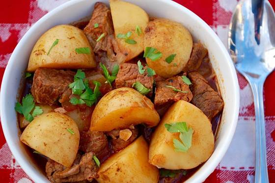

**Slow Cooker Beef and Potato Stew**

Ingredients
* 2 tablespoons olive oil
* 3.5 lbs. stew meat, cut into 1-inch
  pieces
* 2 tsp salt
* 1 tsp fresh ground pepper
* 2.5 lbs baby yellow potatoes,
  quartered
* 1 onion, diced
* 4 cloves garlic, minced
* 2 tsp. dried thyme
* 1 tsp paprika
* 1 bay leaf.
* 3 cups beef broth
* 16 oz. can tomato sauce
* 2 tbs Worcestershire sauce
* 1/4 cornstarch
* 1/2 cup water
* 2 tablespoons chopped fresh parsley
  leaves

Instructions
1. Heat olive oil in a large skillet
   over medium heat.
2. Season beef with salt and pepper.
3. Add beef to the skillet and cook
   until evenly browned, about 2-3 minutes.
4. Place beef in 6 quart slow cooker.
5. Add potatoes, onion, garlic, thyme,
   paprika, and bay leaf.
6. Stir in beef broth, tomato sauce,
   and Worcestershire sauce.
7. Cover and cook on low for 7-8 hours
   or high for 3-4 hours.
8. In a small bowl, whisk together
   corn starch and water until it forms a smooth paste.
9. Add cornstarch mixture to slow
   cooker.
10. Cover and cook on high heat for an
    additional 30 minutes, or until thickened.
11. Top with parsley
12. Enjoy!

By
Rose Ziemann

