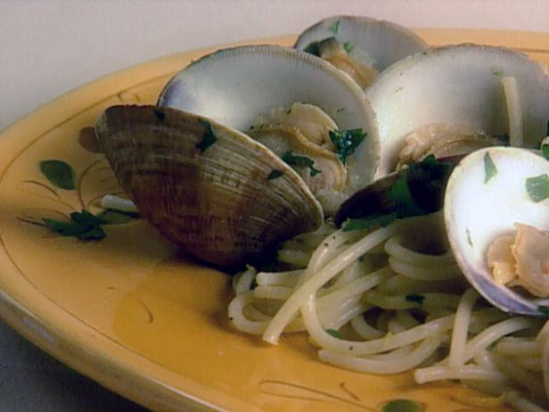

# Spaghetti with Clams

Recipe
courtesy of [Giada De Laurentiis](http://www.foodnetwork.com/profiles/talent/giada-de-laurentiis)

**Ingredients**

* 1 pound dried spaghetti
* 1/2 cup extra-virgin olive oil
* 2 shallots, thinly sliced
* 5 to 7 cloves garlic, finely
  chopped
* 2 1/2 pounds Manila clams, scrubbed
  clean
* 1/2 cup fresh parsley, chopped
* 1/2 cup dry white wine
* 2 tablespoons unsalted butter,
  diced into small cubes
* Sea salt and freshly ground black
  pepper
* 1 lemon, zested, for garnish

### Directions

1.
In a large pot, bring to a boil 6 quarts of salted water. Add
pasta, stirring constantly in the beginning to prevent it from sticking
together. Cook until al dente, about 8 minutes.

2.
Meanwhile, heat the olive oil in a large saute pan. When almost smoking,
add shallots and garlic and saute until soft and translucent, about 3 to 4
minutes, being careful not to burn the garlic. Add the clams and wine. Cover
and simmer for 6 to 8 minutes or until most clams have opened.

3.
Add 2 tablespoons chopped parsley. Whisk in butter to thicken sauce
slightly.

4.
Drain pasta in a colander. Do not rinse pasta with water - this will
remove the pasta's natural starches. Place pasta into the clam saute pan and
mix thoroughly. Check seasoning.

5.
Pour pasta into large serving bowl. Zest lemon over the dish, being
carefull not to zest the white part of the lemon, which is bitter. Garnish with
remaining parsley. Serve immediately.

