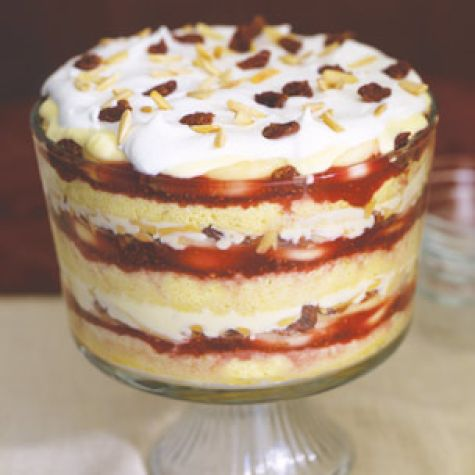

[Crème Anglaise](https://www.williams-sonoma.com/recipe/creme-anglaise.html)
French in origin, crème anglaise is a vanilla-flavored custard sauce that is served over cake, fruit or other desserts. It can also be used to create a traditional English trifle.
Ingredients:
2 cups milk
2 eggs plus 1 egg yolk
1⁄4 cup sugar
2 tsp. vanilla extract

Directions:
Rinse the inside of a nonaluminum saucepan with water and shake out the excess water. Pour in the milk, place over medium-low heat and cook until small bubbles form around the edges of the pan, about 5 minutes.

In a small bowl, combine the eggs, egg yolk and sugar and whisk just until blended. Gradually whisk in half of the hot milk, then pour the egg mixture into the pan. Set over low heat and cook, stirring constantly, until the mixture is thick enough to coat the back of a spoon and leaves a clear trail when a finger is drawn through it, 6 to 8 minutes. Do not allow it to boil.

Strain the mixture through a fine-mesh sieve into a bowl. Stir in the vanilla. Cover with plastic wrap, pressing it directly on the surface to prevent a skin from forming, and let cool. Refrigerate for at least 2 hours or for up to 2 days.

