# [Hong Kong Style Chicken Pot Pies (鸡 批)](<http://thenewartofbaking.blogspot.com/2011/06/hong-kong-bakery-style-chicken-pot-pie.html>)

*<u>Ingredients</u>* **(Makes 12 mini pies)**

***For the Crust***
320g all purpose flour (about 12 oz)
4 tsp custard powder
1/4 tsp baking soda
200g butter, softened at room temperature (about 7 oz)
1 large egg, beaten
30g powdered sugar (about 1 oz)

***For the Filling***
1 boneless, skinless chicken breast (about 10oz or 280gm)
40 gm carrot, corn and pea mix (about 1/4 to 1/3 cup)
4 pieces of white mushrooms, sliced thin
1 medium onion, chopped fine
1 Tbsp butter

***Marinade for Chicken***
2 tsp chinese cooking wine or dry sherry
2 tsp soy sauce
2 tsp corn starch
1 tsp sesame oil
1/4 tsp black pepper

***Sauce***
2 Tbsp butter
2 Tbsp flour
200 ml water + 60 ml milk
2 tsp chicken granules or bouillon
1/2 tsp salt
1/4 tsp sugar

1 egg + 1 tsp oil for glaze

**Directions**

Step 1: Prepare the filling.

Step 2: Combine chicken cubes
with marinade. Set aside.

Step 3: In a pan over medium
heat, melt 1 Tbsp of butter. Add in onion and cook till softened.

Step 4: Add in the diced chicken.
Cook for 5 minutes.

Step 5: Add in the mixed
vegetables and mushrooms.

Step 6: Stir well to combine and
make sure that chicken is cooked all the way through. Dish out and set aside.

Step 7: In a clean pan, melt 2
Tbsp butter over low heat. Add in flour. Cook for 2-3 minutes over low heat to
make a white roux.

Step 8: Add in the chicken and
vege mix. Stir to coat well with the roux.

Step 9: Add in the milk, water,
chicken bouillon, salt and sugar mix.

Step 10: Turn heat up to medium
high and cook till chicken filling comes to a boil. Sauce should be thick and
coat the filling well. Dish out and set aside to cool.

Step 11: Prepare the pie crust.
In a large bowl, sift together flour, baking soda and custard powder.

Step 12: In a separate bowl, beat
the softened butter till light and fluffy.

Step 12: Add in the powdered
sugar. Beat till well combined.

Step 13: Add in beaten egg. Mix
till well combined.

Step 14: Mix in the flour. I find
that it is easier to work with your hands to combine the butter and flour mix.

Step 15: Divide the dough into
two. One for the bottom and the other for the upper crust. Wrap doughs in
plastic wrap. Chill in refrigerator for 30 minutes.

Step 16: Lined a 12-cup muffin
pan with paper cups. Bring out one of the pate brisee from the refrigerator.
Cut into 12 equal pieces.

Step 17: Place one square of
dough into each paper cups. Using your thumbs, press the dough to cover the
entire surface of the paper cups as evenly as you possibly can. ~~Dork~~ Dock
the dough.

Step 18: Preheat oven to 400F.
Place 1 1/2 Tbsp of chicken pie filling into the dough. Bring out the second
dough from the fridge and cut into 12 equal pieces. Flatten dough by pressing
it in between your palms. Place dough on top of chicken pie as upper crust.
Using your fingers, gently seal the pie.

Step 19: Combine one egg with 1
tsp of oil. Glaze the crust with the egg wash.

Step 20: Bake pies at 400F for 10
minutes. Reduce the heat to 350F and continue baking for another 15 minutes
till golden brown.

Let cool for at least 10 minutes
before serving.

**Hong Kong Bakery Style Chicken Pot Pie**

As a succession
to the Hong Kong bakery style baked goods I have featured previously, this is
another favorite from the oriental bakery.

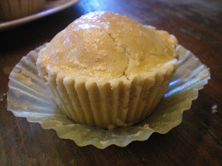

The distinct
difference between the American version of chicken pot pie to those of the Hong
Kong style is the use of pate brisee in the latter version instead of the
regular puff pastry. Pate Brisee in short is a crumbly buttery sweet crust used
for either sweet or savory fillings. I love the crust made using this method as
it gives the pie a rich sweet taste, the perfect contrast to the savory chicken
pot pie filling.

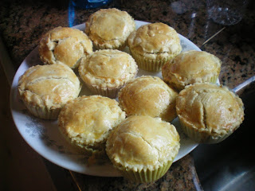

Do not be fool
by the size of this pies. They may look small but the pate brisee crust can do
a great job filling you up even for the biggest appetite. The use of pate
brisee makes it tedious to form the pies as you have to use your fingers and
shape each one individually as opposed to rolling it out in a large sheet.
Believe me, I try rolling out the dough but it just wouldn't work.

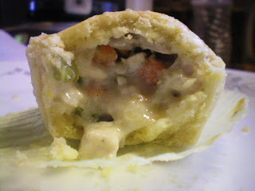

Now, this is
what I called perfection.

**Hong Kong Style Chicken Pot Pies**
**(Makes 12 mini pies)**

*<u>Ingredients</u>*

***For the Crust***
320g all purpose flour (about 12 oz)
4 tsp custard powder
1/4 tsp baking soda
200g butter, softened at room temperature (about 7 oz)
1 large egg, beaten
30g powdered sugar (about 1 oz)

***For the Filling***
1 boneless, skinless chicken breast (about 10oz or 280gm)
40 gm carrot, corn and pea mix (about 1/4 to 1/3 cup)
4 pieces of white mushrooms, sliced thin
1 medium onion, chopped fine
1 Tbsp butter

***Marinade for Chicken***
2 tsp chinese cooking wine or dry sherry
2 tsp soy sauce
2 tsp corn starch
1 tsp sesame oil
1/4 tsp black pepper

***Sauce***
2 Tbsp butter
2 Tbsp flour
200 ml water + 60 ml milk
2 tsp chicken granules or bouillon
1/2 tsp salt
1/4 tsp sugar

1 egg + 1 tsp oil for glaze

**Directions**

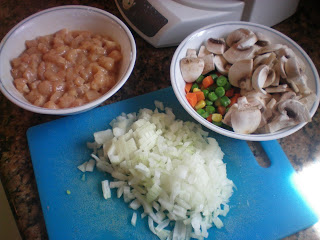

Step 1: Prepare
the filling.

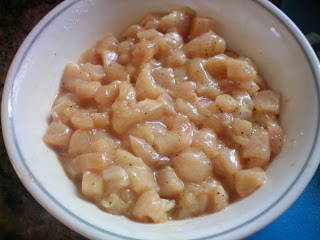

Step 2: Combine
chicken cubes with marinade. Set aside.

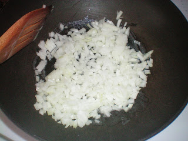

Step 3: In a pan
over medium heat, melt 1 Tbsp of butter. Add in onion and cook till softened.

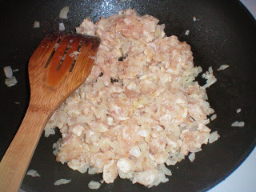

Step 4: Add in
the diced chicken. Cook for 5 minutes.

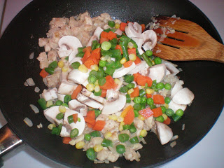

Step 5: Add in
the mixed vegetables and mushrooms.

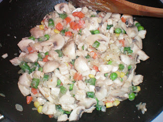

Step 6: Stir
well to combine and make sure that chicken is cooked all the way through. Dish
out and set aside.

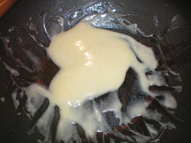

Step 7: In a
clean pan, melt 2 Tbsp butter over low heat. Add in flour. Cook for 2-3 minutes
over low heat to make a white roux.

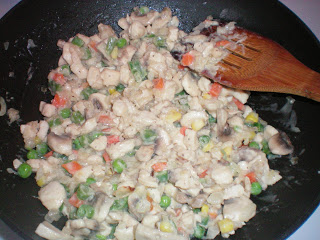

Step 8: Add in
the chicken and vege mix. Stir to coat well with the roux.

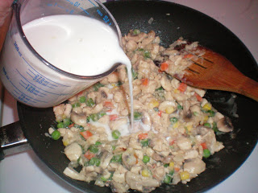

Step 9: Add in
the milk, water, chicken bouillon, salt and sugar mix.

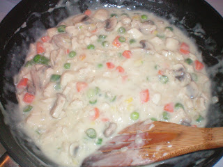

Step 10: Turn
heat up to medium high and cook till chicken filling comes to a boil. Sauce
should be thick and coat the filling well. Dish out and set aside to cool.

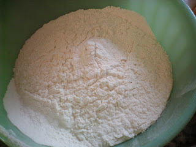

Step 11: Prepare
the pie crust. In a large bowl, sift together flour, baking soda and custard
powder.

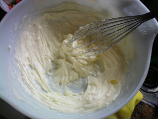

Step 12: In a
separate bowl, beat the softened butter till light and fluffy.

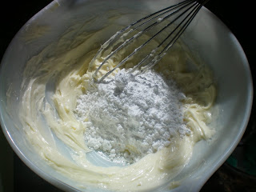

Step 12: Add in
the powdered sugar. Beat till well combined.

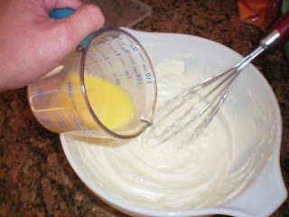

Step 13: Add in
beaten egg. Mix till well combined.

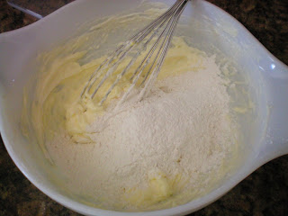

Step 14: Mix in
the flour. I find that it is easier to work with your hands to combine the
butter and flour mix.

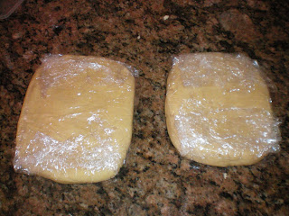

Step 15: Divide
the dough into two. One for the bottom and the other for the upper crust. Wrap
doughs in plastic wrap. Chill in refrigerator for 30 minutes.

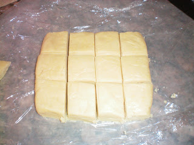

Step 16: Lined a
12-cup muffin pan with paper cups. Bring out one of the pate brisee from the
refrigerator. Cut into 12 equal pieces.

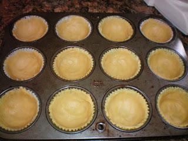

Step 17: Place
one square of dough into each paper cups. Using your thumbs, press the dough to
cover the entire surface of the paper cups as evenly as you possibly can. ~~Dork~~ Dock
the dough.  Dock means poke holes all over the pie dough with a
fork before baking. It helps to ensure your pie crust won't have big air
bubbles during baking.

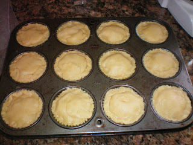

Step 18: Preheat
oven to 400F. Place 1 1/2 Tbsp of chicken pie filling into the dough. Bring out
the second dough from the fridge and cut into 12 equal pieces. Flatten dough by
pressing it in between your palms. Place dough on top of chicken pie as upper
crust. Using your fingers, gently seal the pie.

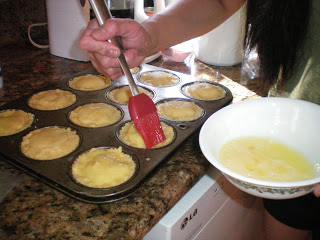

Step 19: Combine
one egg with 1 tsp of oil. Glaze the crust with the egg wash.

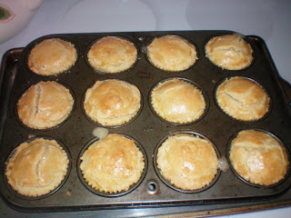

Step 20: Bake
pies at 400F for 10 minutes. Reduce the heat to 350F and continue baking for
another 15 minutes till golden brown.

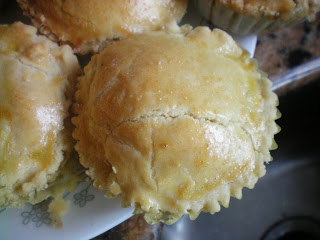

Let
cool for at least 10 minutes before serving.