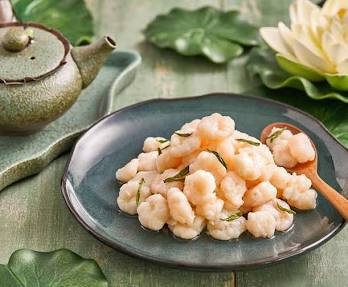
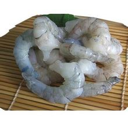
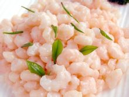

**龙井虾仁**是浙江杭州的传统名菜，以鲜活河虾仁与明前龙井茶嫩芽同炒而成。成菜虾仁玉白、鲜嫩弹牙，茶芽翠绿、清香萦绕，口感甘醇不油腻。

### 口感关键与技巧

- **虾仁处理（滑嫩防腥）**：优先选择鲜活河虾剥壳（或高品质冷冻虾仁）。剥好的虾仁需用清水反复洗去血水至洁白，用吸水纸**完全吸干水分**后再上浆。
    
- **上浆比例**：每 300g 虾仁加入盐 2g、蛋清半个、水淀粉（淀粉 1 小勺 + 水 1 大勺）及少许绍兴黄酒，顺时针搅拌至起胶，封油后入冰箱冷藏腌制 30 分钟以上。
    
- **茶叶冲泡**：选用清明前的龙井新茶 3-5g，用 85°C 左右的热水冲泡 1 分钟即可。**不要泡太久或用沸水**，以免茶汤发苦、叶片黄变。
    
- **温油滑熟**：炒制时油温控制在四成热（约 120°C-130°C），下虾仁快速划散至变色打卷（约 15-20 秒）即捞出控油，切忌大火久炒。
    

### 家常做法

#### 原料准备

- **主料**：新鲜虾仁 300g、龙井茶叶 3-5g
    
- **辅料**：蛋清 1/2 个、水淀粉 1 大勺、盐 3g、绍兴黄酒/料酒 1/2 茶匙、植物油（如花生油或葵花籽油）适量
    

#### 步骤说明

1. **处理与上浆**：虾仁挑去虾线，洗净并吸干水分。加入盐、黄酒、蛋清抓匀至粘手，再加入水淀粉拌匀，最后淋少许植物油封住水分，放入冰箱冷藏腌制 30 分钟。
    
2. **泡茶备用**：用 85°C 热水约 80ml 冲泡龙井茶，泡出香味后滤出茶汤，留适量茶叶与 2 大勺茶汤备用。
    
3. **温油滑虾**：锅中倒入较多植物油，烧至四成热（插入筷子周围冒微小气泡），倒入虾仁迅速划散，待虾仁变红蜷曲（约 8 成熟）立即捞出沥油。
    
4. **快速合炒**：锅留底油，倒入滑好的虾仁，随后淋入 2 大勺浓郁的龙井茶汤和泡好的茶叶，加少许盐，大火快速翻炒 5-10 秒，出锅装盘。

