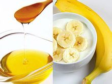
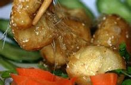
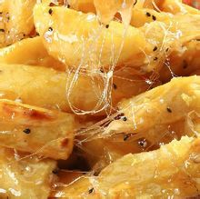

拔丝香蕉是以香蕉、糖、鸡蛋为主要食材的汉族传统名菜，属鲁菜系。

菜品外脆里嫩，甜糯可口。色泽浅黄微亮，质地柔软鲜嫩，吃时[蘸水](http://baike.baidu.com/view/2084897.htm)拔丝，香甜可口沁心。

山东是拔丝菜的发祥地，著名菜肴还有拔丝苹果、拔丝山药、拔丝红薯、拔丝金枣、拔丝樱桃、拔丝香蕉等。

中文名

拔丝香蕉

主要食材

香蕉300克，鸡蛋1个，面粉10克，淀粉50克

分类: 山东菜

口味: 甜糯

**菜品特色**

拔丝香蕉是以香蕉和鸡蛋为主要食材的山东菜，菜品外脆里嫩，甜糯可口。色泽浅黄微亮，质地柔软鲜嫩，吃时[蘸水](http://baike.baidu.com/view/2084897.htm)拔丝，香甜可口沁心。

山东是拔丝菜的发祥地，著名菜肴有拔丝苹果、拔丝山药、拔丝红薯、拔丝金枣、拔丝樱桃、拔丝香蕉等。

我国古代举办宴席，有先咸菜馔后甜菜肴的排列顺序。拔丝、蜜汁、蜜饯等烹饪技法都是山东民间流传下来的甜菜肴绝活 儿，据说在清代已相当知名。著名的山东淄川籍文学家、《聊斋志异》作者蒲松龄十分熟知甜菜的制作方法，平时也很爱吃甜食。他的《聊斋文集》中就有“而今北 地兴揠果，无物不可用糖粘”的语句，便是很形象地对山东地区流行拔丝甜菜的证明。大约到了清末民初时期，山东的拔丝菜迅速走向全国，先是京津苏沪，再往后 各地餐馆、饭店都有拔丝菜供应了，非常受广大消费者的喜爱。

**做法**

**做法一**

**制作食材**

香蕉300克，鸡蛋1个，面粉10克，淀粉50克，食用油500克（实耗100克），白糖3大匙。

**制作流程**

1.香蕉去皮切块，拍上少许干淀粉，将鸡蛋打入碗内，加上面粉、淀粉、水、少许油搅成糊；

2.锅内倒入油，烧热，将香蕉逐个挂上糊后放入炸成金黄色，待香蕉浮起后，捞起沥油；

3.将锅洗净加少许清水和白糖，炒至汁变黄起小泡时，放入炸好的香蕉翻几次，盛在抹上油的盘子上，配上一碗凉水即可。

**制作****贴****士**

为使得香蕉外皮更脆，也可复炸一遍。略撒黑芝麻可增加香味。

**做法二**

**制作食材**

香蕉……3根(大)
蛋……2个

面粉……1饭碗
沙拉油……6饭碗
黑芝麻……2小匙
砂糖……6大匙
水……2小碗
纯麦芽……1大匙

**制作流程**
1. 先把香蕉剥去外皮，切成小段或滚刀快，滚上一层面粉，放入用鸡蛋清加淀粉和成的稠糊中，把香蕉块段上浆拌匀，待用。把油锅烧热，油温不宜很高，烧至四五成热时，把拌好糊的香蕉块、段逐个放入油锅中炸，炸成金黄色时捞出。  

2. 油锅内放入白糖（白糖与油的用量比例为50克白糖用15克油），油温不要太高，用勺把溶化的糖慢慢搅动，熬至糖 浆呈浅黄色、能抽出糖丝时，即把炸好的香蕉块、段放入糖浆中，离火，快速翻动，使糖浆均匀地裹于香蕉炸料上，便可装盘，放上红绿瓜丝食用。这样的拔丝香 蕉，颜色金黄，脆软香甜。  
3. 进食拔丝香蕉需随一碗冷开水上桌，把拔丝香蕉蘸一下冷开水，使糖浆温度降低，吃时可不粘牙，也更为香脆。  

**制作****贴****士**

1. 刚拌好的香蕉没有拔丝现象，等温度稍低，糖汁快凝结时，夹起香蕉才会带起细丝。
2. 这道甜点须趁热吃，免得冷後糖汁凝固，不易下筷。
3. 在盘子上抹油可以防止香蕉块粘到盘子上。

**做法三**

**制作食材**

香蕉600克、玉米粉60克、面粉12克、鸡蛋清60克。

**制作流程**

1、将香蕉剥去皮，切成滚刀块，放在面粉上滚蘸一层；

2、把鸡蛋清倒入玉米面中，搅和成糊；

3、把植物油倒入炒勺内，在旺火上烧7～8成热，把裹好面粉的香蕉再裹上一层蛋清糊，一个一个地放入油中浸炸。炸到浅黄色后，捞出控净油；

4、炒勺留点底油，放入白糖炒到金黄色，大泡变小泡，最后颜色加深，可以拔丝时，倒入香蕉块、青、红丝，快速颠翻均匀，盛入预先擦好一层油的盘中，码摆整齐即成。

**做法四**

**福建菜****谱之拔丝香蕉****(****尤其福州菜以甜****为主色调****)****：**

**制作食材**

香蕉3根、蛋2个、面粉1碗、砂糖6匙、纯麦芽1匙、沙拉油6碗、黑芝麻2匙。

**制作流程**

香蕉去皮，切成滚刀块；蛋打匀，与面粉拌合；砂糖、清水、纯麦芽在锅中煮，待砂糖溶化，用小火慢慢熬黄；糖快好时，另锅将沙拉油烧热，香蕉块沾裹面糊投入油中，炸至金黄色时捞出，倒出糖汁中拌匀；稍撒黑芝麻。

**做法五**

**原料**

主料：香蕉

辅料：淀粉、[蛋清](http://baike.baidu.com/view/456777.htm)

调料：白糖、油

## 详细步骤
1. 将香蕉剥去皮，切成滚刀块，放在面粉上滚蘸一层。
2. 把鸡蛋清倒入玉米面中，搅和成糊。
3. 把植物油倒入炒勺内，在旺火上烧7～8成热，把裹好面粉的香蕉再裹上一层蛋清糊，一个一个地放入油中浸炸。炸到浅黄色后，捞出控净油。
4. 炒勺留点底油，放入白糖炒到金黄色，大泡变小泡，最后颜色加深。
5. 可以拔丝时，倒入香蕉块、青、红丝，快速颠翻均匀，盛入预先擦好一层油的盘中，码摆整齐即成。[

**做法六**

主料：香蕉 五根

辅料：白砂糖 80-100克、玉米淀粉、鸡蛋

**详细步骤**

1.
香蕉切滚刀块，另用生粉和鸡蛋调面糊

2.
香蕉块挂糊

3.
入油锅炸。注意油温不要太高

4.
炸至香蕉块表面金黄就捞出

5.
另起一锅，加少量油和大量糖，熬糖稀。依然要注意油温，千万别让糖糊了。

6.
糖会先起小泡，然后变大泡，颜色也越来越深，要熬成深黄色的糖稀。

7.
把炸好的香蕉块投入油锅，让香蕉块均匀挂上糖稀。乘盘即可～[2]

材料：糖、香蕉
裹粉料：泡打粉1小匙、太白粉1大匙、麵粉7大匙、油1大匙、水85cc

作法：
1.取碗，倒入所有裹粉料拌勻；將香蕉灑上少許太白粉(份量外)抓勻，放入調好的粉漿­中，備用。
2.起油鍋，將做法1的香蕉炸至表面金黃，撈起瀝乾。
3.另起鍋，加少許油，放入糖小火炒至溶解後，倒入作法2炸好的香蕉拌勻即可。
