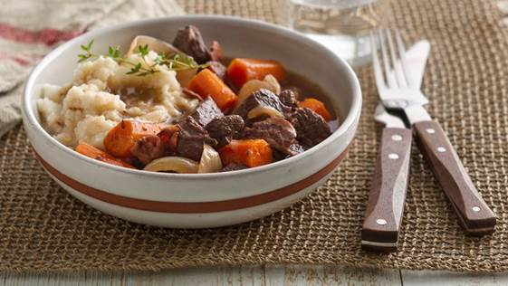

Beef Bourguignon 
(Beef Burgundy, French Beef stew)
https://www.recipetineats.com/beef-bourguignon-beef-burgundy/

Beef Marinade:
800g/1.6 lb 			Chuck Beef
2   					large carrots
16 						pearl onions 
1 						bay leaf
3 springs 				thyme
750ml/25oz/1bottle  	pinot noir(lighter red wine)

Browning Beef
3 tbsp oil
3/4 tsp salt
1/2 tsp pepper

Stew 
200g/7oz  mushrooms
150g/5oz  bacon
50g/3 tbsp unsalted butter
3 garlic cloves
2 tbsp tomato paste
6 tbsp flour
3 cups beef stock 
1/4 tsp salt
2 tbsp chopped parsley

Instructions:
Part 1: Beef Marinade
1. Marinate beef: Beef + onions + carrot + thyme = Bay leaves + Red Wine 
	for 12-24 hours
2. Strain: split beef, veg and red wine
3. Reduce wine: Simmer until reduced by half(about 7 min on medium)
4. Beef: until the beef, season beef with salt and pepper. 

Part 2: Making the Stew
1. Brown beef.
2. Bacon: Cook the bacon, leave the fat
3. Add garlic.
4. Onion next: just cook until you get some nice golden patches.
5. add mushrooms. Cook then put aside.
6. add Carrots last + butter
7. Tomato paste and flour
8. Add beef Stock + reduced red wine
9. Add beef, bacon, thyme and bay leaves.

Part 3. Slow-Cooking
1. slow-cooking
2. add Onion and mushroom.

---
## Slow Cooker Beef Bourguignon
 1. In 7-quart Dutch oven or stockpot,
   heat oil over high heat. Pat beef dry with paper towels, and season with
   salt and pepper. Place beef in Dutch oven, working in batches if necessary
   as to not overcrowd Dutch oven, and cook 4 to 6 minutes, searing all sides
   of beef. Transfer to plate.
2. Add carrots and onion to Dutch
   oven, and cook 3 to 5 minutes or until onions and carrots are lightly
   browned and slightly tender, scraping brown bits up from bottom as they
   cook. Add garlic, and cook 1 minute longer, stirring frequently. Add wine,
   beef broth and thyme to Dutch oven, and stir until well combined.
3. Place broth mixture in 5- to
   6-quart slow cooker; add beef and bacon to slow cooker. Cover and cook on
   Low heat setting about 8 hours or High heat setting 4 to 5 hours or until
   beef is very tender. Spoon into bowls to serve. Garnish with fresh thyme
   sprigs, if desired.
4. Freezer Directions: Make as directed
   through step 2. Place beef in gallon-size plastic freezer bag. Squeeze out
   any excess air, and seal. Place broth mixture and bacon in gallon-size
   plastic freezer bag. Squeeze out any excess air, and seal. Place bags flat
   to freeze. When ready to cook, thaw bags overnight in refrigerator. Place
   in 5- to 6-quart slow cooker; cover and cook on Low heat setting about 8
   hours or High heat setting 4 to 5 hours or until beef is very tender.
   Garnish with fresh thyme.