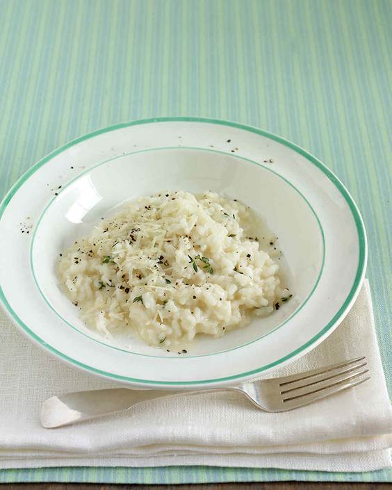

# Creamy Risotto

Martha Stewart

**Ingredients**

* 3 tablespoons olive oil
* 1 small onion, finely chopped
* 1 1/2 cups Arborio rice
* 3/4 cup dry white wine
* 4 1/2 cups reduced-sodium canned
  chicken broth
* 3/4 cup grated Parmesan cheese
* 2 tablespoons butter
* Fresh thyme leaves, for garnish
  (optional)

**Directions**

1. In a medium saucepan, heat oil over
   medium heat. Saute onion until tender, about 5 minutes. Add rice; cook,
   stirring until well coated, 1 to 2 minutes. Add wine; cook, stirring until
   absorbed, about 1 minute. Season with salt. Gently heat broth; keep warm.
2. Add about 1 cup of warm broth.
   Cook, stirring frequently, until absorbed. Continue adding broth, 1 cup at
   a time, stirring until most of the liquid has been absorbed, about 25
   minutes total. The rice should be tender (but not mushy) and suspended in
   liquid with the consistency of heavy cream.
3. Remove pan from heat. Stir in
   Parmesan and butter; season with salt and pepper. Serve immediately
   (risotto will continue to thicken as it sits). Garnish with thyme leaves,
   if desired.

